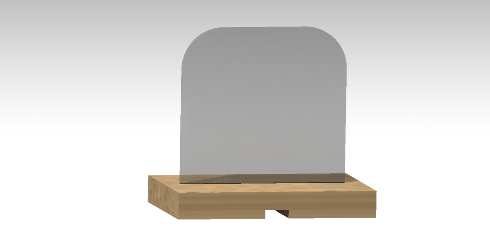
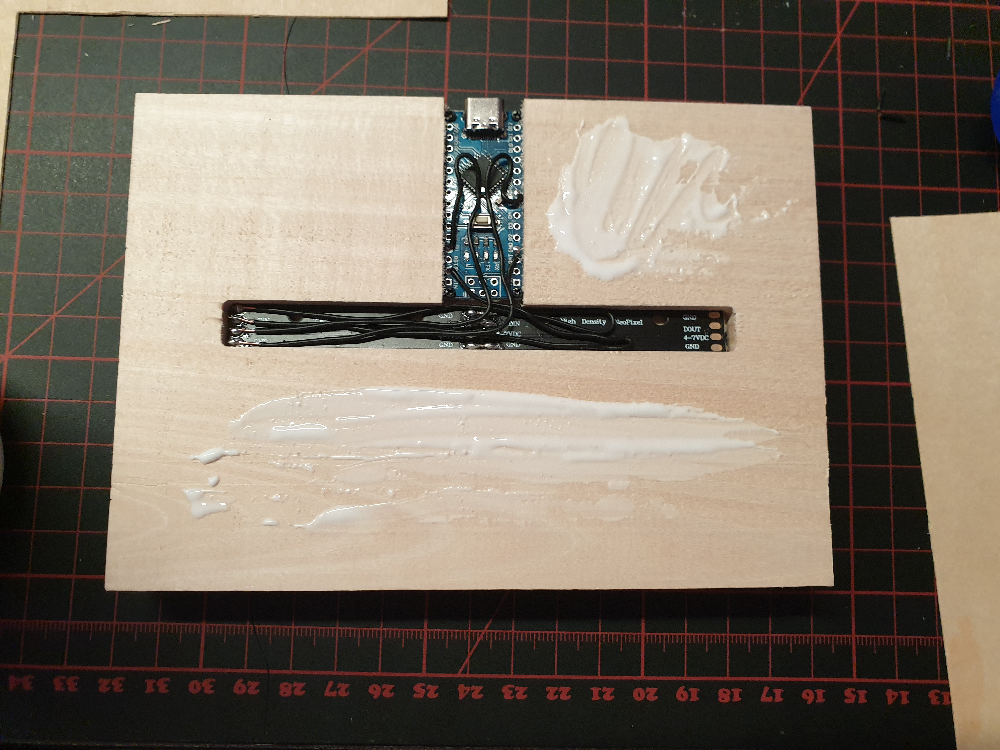
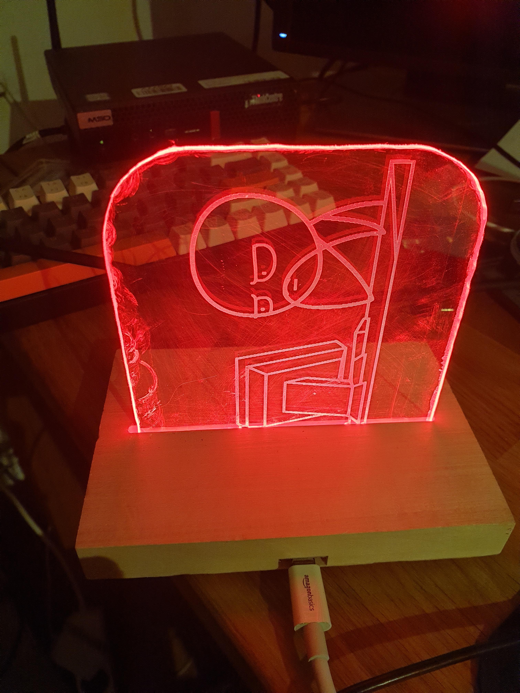
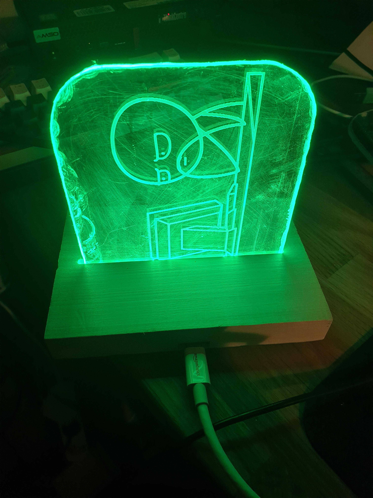

# Contents

- [MS Teams Busy Light](#ms-teams-busy-light)
- [Hardware](#hardware)
	- [Electronics](#electronics)
- [Software](#software)
	- [Installation as a User](#installation-as-a-user)
	- [Developer setup and build](#developer-setup-and-build)
	- [Settings](#settings)
	- [Arduino setup and flashing](#arduino-setup-and-flashing)
	- [New Teams presence status](#new-teams-presence-status)
- [Results and Assembly](#results-and-assembly)
	- [Assembly](#assembly)
	- [Results](#results)
- [Reference / Link Collection](#reference--link-collection)
# MS Teams Busy Light

Repository for a DIY Busy light, that should represents the Teams presence status in a small box, that will turn a plexiglass 
with indirect LED light into a matching presence color.


# Hardware

Disclaimer regarding the choice of Hardware: Although there is some hardware that would better fit for the purpose, 
I decided to use the following items, because I had (at least some of them) already in my drawer. 

* plexiglass sheet
* Arduino Nano (Chip: Atmel atmega328p Xplained mini)
* wood 
* WS2812 5050 RGB LEDs (Neopixel)

I created a CAD Modell of it, using Catia. Besides the Part Modell itself, I created the drawing of the plexiglass and 
wooden stand, as well as their PDF exports, so you don't need Catia to open them. Here you can see a first rendering of the model: 


## Electronics
Find the Wiring Diagram of the Neopixel RGB Strips and the Arduino below. They will fit to the bottom of the wooden stand. 


# Software

## Installation as a User

As a user you just need to download the latest version from [releases](https://github.com/MarcelSchm/MS-Teams-Busy-Light/releases) and run the .exe file. 

## Developer setup and build

The application is tested with Python 3.14. Install Git and Python 3.14, then clone
the repository and create a virtual environment from PowerShell:

```powershell
git clone https://github.com/MarcelSchm/MS-Teams-Busy-Light.git
cd MS-Teams-Busy-Light
py -3.14 -m venv .venv
.\.venv\Scripts\python.exe -m pip install --upgrade pip
.\.venv\Scripts\python.exe -m pip install -r requirements-dev.txt
.\.venv\Scripts\python.exe -m pytest
```

`requirements.txt` contains only the application runtime dependencies.
`requirements-dev.txt` also installs test and packaging tools. To build the
Windows executable and ZIP package locally, run:

```powershell
.\createNewTeamsBusyLightExe.ps1
```

The build does not change Windows Defender settings by default. If Defender
blocks the build, an administrator can opt in to a temporary exclusion for the
`dist` folder with `-AllowDefenderExclusion`; the script removes it after the
build, including when PyInstaller fails.

The scripts in `experiments/` are unmaintained prototypes and are not part of
the application or release build.

The release script checks local and remote tags and asks for confirmation
before committing, tagging, and pushing. Preview the operation with
`.\create_changelog_and_tag.ps1 -DryRun` or `-WhatIf`.

GitHub Actions runs tests on Ubuntu and publishes source-only releases; it
does not build or attach a Windows executable. Use the local build script above
to create the executable.

## Settings

`MS_Teams_Settings.ini` is stored next to the executable. It contains the Teams
log-folder path, the log key to search for, recognized status names, and
optional debug logging settings. The application currently supports only the
new Teams log format; `newTeams` must remain `True`. In the INI file,
`%%localappdata%%` is intentional: `configparser` uses `%%` to represent a
literal percent sign before Windows expands the environment variable.

## Arduino setup and flashing

1. Install the Arduino IDE and the **Adafruit NeoPixel** library using the
   Library Manager.
2. Open `Arduino_Nano_LED_Script/Arduino_Nano_LED_Script.ino`.
3. Select the connected Arduino Nano and its COM port. Select the processor
   variant that matches your Nano if the upload fails.
4. Upload the sketch. The NeoPixel data line uses pin 6, the sketch is set for
   16 LEDs, and serial communication runs at 9600 baud.

The Python application and Arduino sketch must both be running for the light
to reflect Teams presence. The `BLINKRED` serial command performs a red call
blink, including when the light is already showing red.

## New Teams presence status

The application reads the newest matching log file from:

```text
%LOCALAPPDATA%\Packages\MSTeams_8wekyb3d8bbwe\LocalCache\Microsoft\MSTeams\Logs
```

The legacy Teams `logs.txt` format is not supported. The status is read from
log entries containing `availability:`. Common mappings are:

| Teams status | Light |
| --- | --- |
| Available | Green |
| Busy, In a meeting, In a call, Do not disturb, Presenting | Red |
| Be right back, Away, Offline | Yellow |
| Unknown, Connection error, No network | Red |

The Arduino accepts the `BLINKRED` serial command for an incoming-call blink.
The current Teams log reader extracts `availability:` values; it does not yet
decode separate call-control events such as `reportIncomingCall`.

The Windows application version is maintained in `version.conf`; the Arduino
startup message does not duplicate that version.


# Results and Assembly

## Assembly 
After creating the wooden stand, plexiglas and soldering of the electronics, you need to put everything together. should be selfexplaining, but here have a look of my assembly:

You can see here, that I prepared to glue a thin layer of vaneer wood to the  backside, too cover the electronics. 

## Results
Here you can find some pictures of the current state / final version of the busy light:






# Reference / Link Collection

I gathered the above information from various sources. Here to find the link collection, everything not directly linked above
was just added to this file for the complete Link list, I used for inspiration, even if it was not used at the end. 


[1]: <https://www.reddit.com/r/MicrosoftTeams/comments/iuxcac/diy_busylight/?rdt=45645> "Reddit Discussion"
[2]: <https://github.com/ajobbins/AHK-Teams-Presence> "AutoHotKey Log"
[3]: <https://github.com/JnyJny/busylight> 
[4]: <https://github.com/toblum/ESPTeamsPresence>
[5]: <https://www.eliostruyf.com/diy-building-busy-light-show-microsoft-teams-presence/>
[6]: <https://learn.microsoft.com/en-us/graph/api/presence-get?view=graph-rest-beta&tabs=http#code-try-1>
[7]: <https://www.hackster.io/benedikt-hubschen/office-busylight-1a8e30>
[8]: <https://teamsqueen.com/2021/08/19/a-busylight-with-microsoft-teams/>
[9]: <https://www.chiark.greenend.org.uk/~sgtatham/putty/latest.html>


